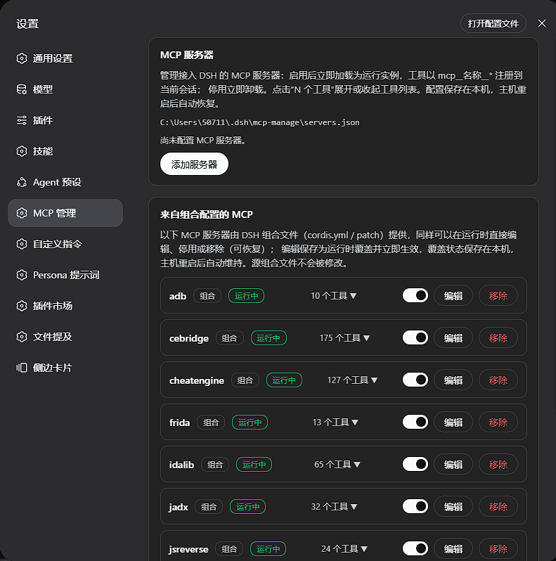

# dsh-mcp-manage

[English](#english) | 中文

DSH（DeepSeek Harness）Web GUI 的 MCP 管理插件：在 **设置 → MCP 管理** 页面里查看、添加、编辑、删除、启用/停用 MCP 服务器；组合配置（cordis.yml / patch）提供的 MCP 同样可在运行时直接管理。全部操作即时生效，无需重启宿主，也无需修改任何 dsh 源码。

 [](LICENSE)



## 功能

- **查看所有已安装的 MCP 工具**：每个服务器以“N 个工具”可点击计数展示，点击展开/收起工具列表（`mcp__名称__*`），默认隐藏。
- **添加**：支持 `stdio`（本地命令 + 参数 + 环境变量 + 工作目录）与 `streamable-http`（URL + 附加请求头）两种传输；保存后立即加载为运行实例，工具马上注册到会话。
- **修改**：编辑任意字段后自动以新配置重启该实例。
- **删除**：卸载运行实例并删除持久化记录。
- **启用 / 停用**：一键开关，停用立即卸载、启用立即加载。
- **组合配置的 MCP 同样可管**：cordis.yml / patch 提供的行（如 cebridge）可在运行时**直接编辑**——表单从当前配置预填，保存为运行时覆盖并立即重启（停用中的行保持停用，配置待下次启用生效；编辑在停用/启用之间保留，改错再次编辑即可），也可停用或移除（可随时恢复）。覆盖状态持久化并在宿主重启后自动维持；**源组合文件不会被修改**。
- **持久化**：记录与覆盖保存在 `$DSH_HOME/mcp-manage/servers.json`，宿主重启后自动恢复所有已启用的服务器并维持组合覆盖。
- **启动失败可见**：默认 `failOnStartupError`，坏定义会显示“启动失败”及错误信息，而不是静默后台重试。

## 安装

```sh
dsh plugin --profile web add link:<本仓库路径>
# 或发布后：
dsh plugin --profile web add dsh-mcp-manage
```

然后重启 `dsh web`，打开 **设置 → MCP 管理**。

要求：DSH ≥ `0.1.0-rc.6`（组合中已包含 `@deepseek-ai/dsh-web-app`）。

## 卸载

```sh
dsh plugin --profile web remove dsh-mcp-manage
```

管理页删除所有记录后，`$DSH_HOME/mcp-manage/` 可以安全移除。

## 工作原理

- **host 半**（`src/index.ts` + `src/host/`）：在 `ctx.webServer` 上注册 `/api/dsh-mcp-manage/*` 路由族；每个启用的记录通过 `ctx.plugin()` 加载为一个 `@deepseek-ai/dsh-mcp-client` 实例（作为本插件 fiber 的 effect 作用域子节点，插件卸载时自动清理）。`@deepseek-ai/dsh-mcp-client` 从运行中的 dsh 安装解析（可选 peer 依赖），本插件自身不携带它。组合行管理走 Loader 的 `Entry.update` / `group.remove`（**绕过 `tree.write()`**，不物化、不修改源组合文件）：启用开关与配置编辑（`PUT /external/:entryId/config`，载荷与受管编辑同构，经同一 `toConfig` 映射生成客户端配置）都经 `Entry.update` 即时重启行内实例，首次编辑快照原始 loader 选项供还原（`POST /external/:entryId/revert`）。覆盖状态存于本插件存储，通过 `loader/entry-init` / `loader/config-update` 钩子与列表读取时的收敛式强化在启动与热重载后自动重建。
- **client 半**（`src/client/`）：通过 `dsh.client` 声明加载到 Web GUI，向 `settings.section` 槽位注册 "MCP 管理" 导航页，纯 `fetch` 与 host 半通信。
- 工具枚举读取 `ctx.tools.schemas()` 中所有 `mcp__*` 前缀的名字，按 `serverName` 分组——这就是“当前宿主已安装的全部 MCP 工具”的权威列表。

## dsh.bundle 声明清单

本插件在 package.json 的 `dsh` 段声明双面 bundle，该清单是 `dsh plugin` 与 Web GUI 识别并加载本插件的依据：

```json
"dsh": {
  "bundle": { "patch": "./cordis.patch.yml" },
  "client": {
    "inject": [
      "@deepseek-ai/dsh-client-runtime",
      "@deepseek-ai/dsh-client-ui-settings"
    ],
    "platform": "web"
  }
}
```

- **`dsh.bundle.patch`**：bundle 对外导出的组合 patch 层（相对包根的路径）。`dsh plugin --profile <name> add` 据此把本包识别为可安装插件——安装后以补丁层加入该 profile 的 `dsh.profile.bundles` 叠层栈；未声明 `dsh.bundle` 的包只会作为普通依赖安装（伴随告警），不成为任何一层。
- **`dsh.client`**：浏览器半声明。`inject` 列出加载 client 包前需先注入的对等包（运行时与设置页 UI），`platform: "web"` 声明目标平台。

## HTTP API

页面之外，路由族也可直接调用（同源前缀 `/api/dsh-mcp-manage`，统一 JSON 信封 `{ ok, error? }`）：

| 路由 | 说明 |
| --- | --- |
| `GET /servers` | 全量快照：受管行、组合行与存储路径 |
| `POST /servers` | 添加（body `{ server }`） |
| `PUT /servers/:id` | 编辑并重启实例 |
| `DELETE /servers/:id` | 删除 |
| `POST /servers/:id/enabled` | 启用 / 停用（body `{ enabled }`） |
| `POST /external/:entryId/enabled` | 组合行启用 / 停用 |
| `PUT /external/:entryId/config` | 组合行配置编辑（body `{ server }`，与受管编辑同构；保存为覆盖并即时重启） |
| `POST /external/:entryId/revert` | 组合行还原为组合原始配置（无编辑时 404） |
| `DELETE /external/:entryId` | 组合行移除（可恢复） |
| `POST /external/:entryId/restore` | 组合行恢复 |

## 开发

```sh
pnpm install
pnpm run typecheck   # tsc --noEmit
pnpm test            # vitest 单元测试（store 校验 / 往返 / 覆盖携带）
pnpm run build       # tsc 声明 + tsdown（lib/index.js + lib/client.js）
```

`tests/fixtures/echo-mcp-server.mjs` 是零依赖的手写 stdio MCP 服务器，用于端到端验证。

### 已验证的端到端路径

在独立 profile（`--profile mcp-test --port 3999`）上实测通过：外部目录列出 9 个组合 MCP 服务器及其全部工具；添加 / 编辑（实例重启）/ 停用 / 启用 / 删除；组合行停用（175→0 工具）/ 移除 / 恢复（13 工具回归）；停用状态跨宿主重启保持；浏览器表单添加与工具计数点击展开。

组合行运行时编辑的覆盖携带（停用/启用/恢复间保留）与存储往返由单元测试覆盖（`tests/store.spec.ts`，14 项）。

## 许可

[MIT](LICENSE)

<a id="english"></a>

# dsh-mcp-manage (English)

MCP management plugin for the DSH (DeepSeek Harness) web GUI: a **Settings → MCP 管理** page that lists, adds, edits, deletes, and enables/disables MCP servers; MCP rows provided by the composition (`cordis.yml` / patches) are manageable at runtime as well. Everything takes effect immediately — no host restart, no dsh source changes.


## Features

- **List every installed MCP tool**: each server shows a clickable "N 个工具" count that expands/collapses its tool list (`mcp__name__*`), hidden by default.
- **Add**: `stdio` (command / args / env / cwd) and `streamable-http` (URL / headers) transports; saving loads a live instance immediately and its tools register right away.
- **Edit**: restarting the instance under the new config is automatic.
- **Delete**: dispose the live instance and remove the persisted record.
- **Enable / disable**: one toggle — disable unloads at once, enable loads immediately.
- **Composition-provided MCP rows are first-class too**: rows from `cordis.yml` / patches (e.g. cebridge) can be **edited at runtime** — the form prefills from the row's current config, the edit persists as an override and restarts the row immediately (a disabled row stays dormant and picks the config up on the next enable; edits survive toggles, and a mistake is fixed by editing again) — and can equally be disabled or removed (restorable). Overrides persist across host restarts and the **source composition files are never modified**.
- **Persistence**: records and overrides live in `$DSH_HOME/mcp-manage/servers.json`; enabled servers and composition overrides are restored on host start.
- **Loud failures**: bad definitions surface as a failed row with the error text instead of silent background retries.

## Install

```sh
dsh plugin --profile web add link:<path to this repo>
# or, once published:
dsh plugin --profile web add dsh-mcp-manage
```

Restart `dsh web`, then open **Settings → MCP 管理**. Requires DSH ≥ `0.1.0-rc.6` (a web-app composition).

## How it works

The host half serves `/api/dsh-mcp-manage/*` on `ctx.webServer` and loads each enabled record as an `@deepseek-ai/dsh-mcp-client` instance (an effect-scoped child of this plugin's fiber — disposal cascades automatically; the client package resolves from the running dsh installation as an optional peer). The browser half registers the settings page through the `settings.section` slot and talks to the host over plain fetch. Tool enumeration reads `ctx.tools.schemas()` and groups every `mcp__*` name by server namespace. Composition rows are managed through the loader's `Entry.update` / `group.remove` (bypassing `tree.write()` — nothing is materialized back into the source composition files): the enable toggle and the runtime config edit (`PUT /external/:entryId/config`, a payload shaped like the managed edit, mapped through the same `toConfig`) both restart the row's fiber immediately, the original loader options are snapshotted on first edit for revert (`POST /external/:entryId/revert`), and persisted overrides are re-enforced after boot and hot reloads via the `loader/entry-init` / `loader/config-update` hooks.

## dsh.bundle manifest

The plugin declares its dual-face bundle in the `dsh` section of package.json — this manifest is what `dsh plugin` and the web GUI rely on to recognize and load the plugin:

```json
"dsh": {
  "bundle": { "patch": "./cordis.patch.yml" },
  "client": {
    "inject": [
      "@deepseek-ai/dsh-client-runtime",
      "@deepseek-ai/dsh-client-ui-settings"
    ],
    "platform": "web"
  }
}
```

- **`dsh.bundle.patch`**: the composition patch layer the bundle exports (relative to the package root). `dsh plugin --profile <name> add` uses it to recognize the package as an installable plugin — once installed, it joins that profile's `dsh.profile.bundles` layer stack as a patch layer; a package without a `dsh.bundle` declaration installs as a plain dependency (with a warning) and never becomes a layer.
- **`dsh.client`**: the browser-half declaration. `inject` lists the peer packages that must load before the client bundle (the runtime and the settings-page UI), and `platform: "web"` declares the target platform.

## HTTP API

Beyond the page, the route family is directly callable (same-origin prefix `/api/dsh-mcp-manage`; every response is a JSON envelope `{ ok, error? }`):

| Route | Description |
| --- | --- |
| `GET /servers` | Full snapshot: managed rows, composition rows, store path |
| `POST /servers` | Add (body `{ server }`) |
| `PUT /servers/:id` | Edit and restart the instance |
| `DELETE /servers/:id` | Delete |
| `POST /servers/:id/enabled` | Enable / disable (body `{ enabled }`) |
| `POST /external/:entryId/enabled` | Enable / disable a composition row |
| `PUT /external/:entryId/config` | Edit a composition row's config (body `{ server }`, same shape as the managed edit; persisted as an override, restarted immediately) |
| `POST /external/:entryId/revert` | Revert a composition row to its original composition options (404 when nothing to revert) |
| `DELETE /external/:entryId` | Remove a composition row (restorable) |
| `POST /external/:entryId/restore` | Restore a composition row |

## Development

```sh
pnpm install
pnpm run typecheck && pnpm test && pnpm run build
```

`tests/fixtures/echo-mcp-server.mjs` is a dependency-free hand-rolled stdio MCP server used for end-to-end verification (add / edit / toggle / delete / browser form / restart restore were all exercised against a dedicated test profile). The composition-row runtime edit path — override carry-across across toggles/restore and the store round-trip — is covered by unit tests (`tests/store.spec.ts`, 14 tests).

## License

[MIT](LICENSE)

